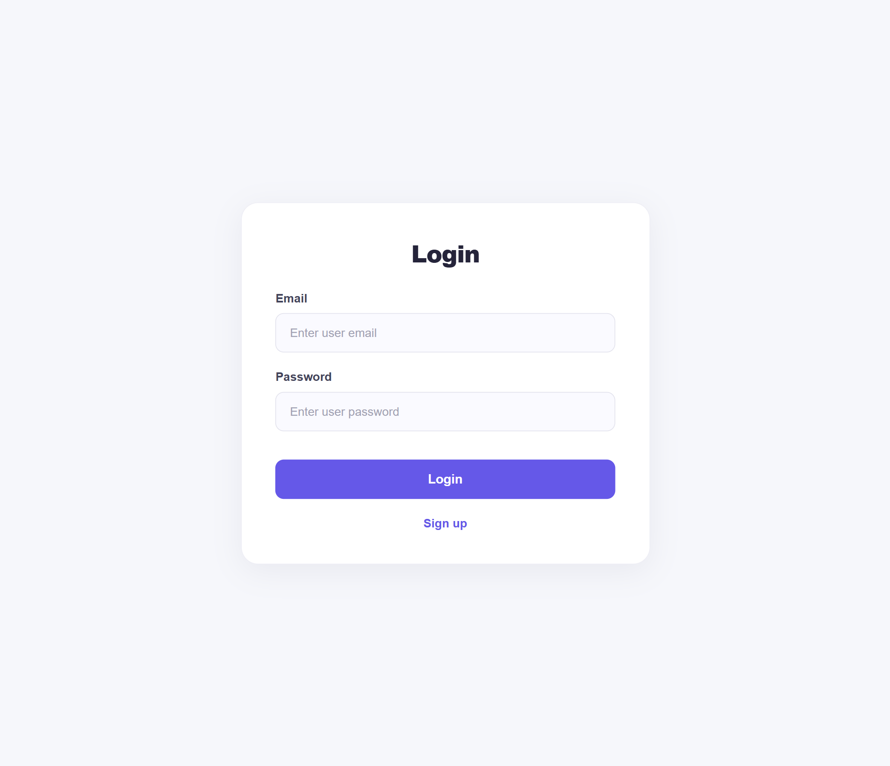
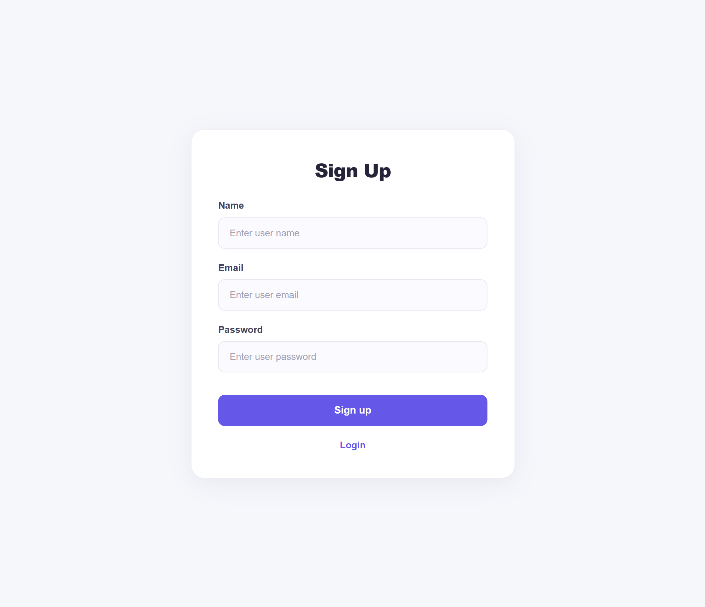
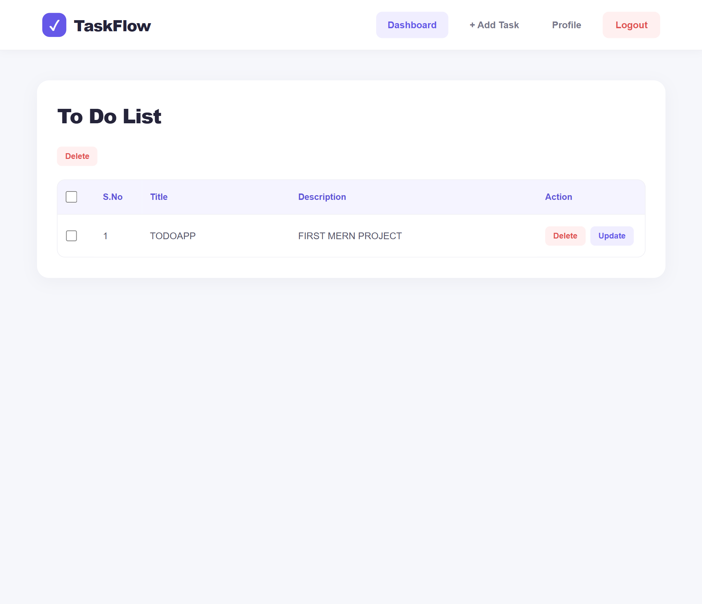
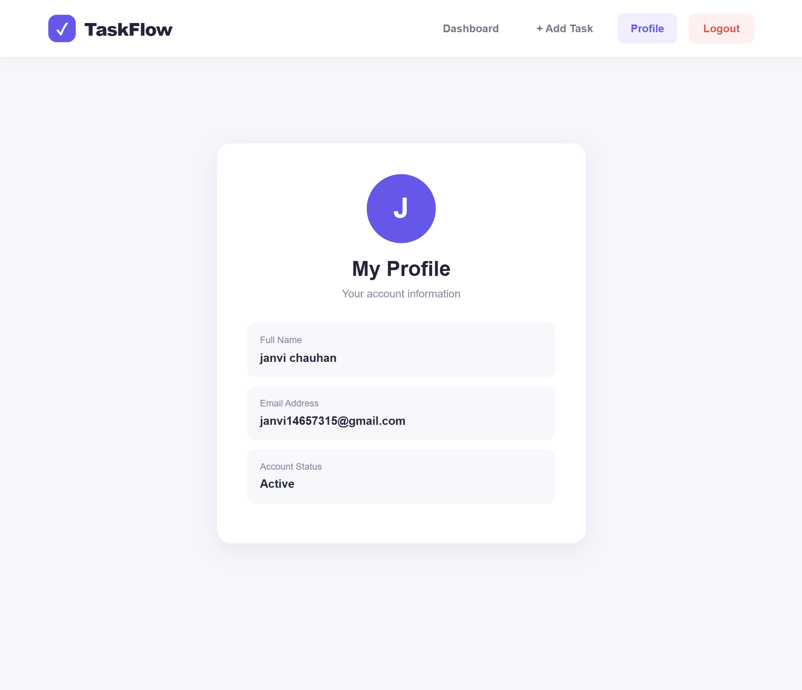

# 📝 Todo App – Full Stack Application

A full-stack Todo Application built using **React.js, Node.js, Express.js, and MongoDB**. Users can create accounts, log in, manage their tasks, and view their personal profiles.

The application uses JWT authentication with HTTP-only cookies to protect user-specific data.

## 🚀 Features

### Authentication
- User registration and login.
- JWT-based authentication.
- HTTP-only cookie authentication.
- Protected routes.
- Logout functionality.
- Duplicate email validation.

### Task Management
- Add new tasks.
- View all personal tasks.
- View individual task details.
- Update existing tasks.
- Delete individual tasks.
- Delete multiple tasks.
- Tasks are associated with the logged-in user's email.

### User Profile
- View profile information.
- Display registered name and email.
- Access protected profile page.

### Security
- JWT authentication middleware.
- User-specific task access.
- Users cannot access or modify another user's tasks.
- Password is excluded from profile API responses.

## 🛠️ Technologies Used

### Frontend
- React.js
- Vite
- React Router DOM
- HTML5
- CSS3
- JavaScript

### Backend
- Node.js
- Express.js
- MongoDB
- MongoDB Node.js Driver
- JSON Web Token (JWT)
- Cookie Parser
- CORS

### Development Tools
- Visual Studio Code
- Thunder Client
- MongoDB Atlas
- Git and GitHub

## 📁 Project Structure

```text
TODOAPP/
│
├── TodoAppBackend/
│   ├── dbconfig.js
│   ├── index.js
│   ├── package.json
│   └── .env
│
├── TodoAppfrontend/
│   ├── public/
│   ├── src/
│   │   ├── components/
│   │   │   ├── AddTask.jsx
│   │   │   ├── List.jsx
│   │   │   ├── Login.jsx
│   │   │   ├── Navbar.jsx
│   │   │   ├── Profile.jsx
│   │   │   ├── Protected.jsx
│   │   │   ├── Signup.jsx
│   │   │   └── UpdatedTask.jsx
│   │   │
│   │   ├── style/
│   │   ├── App.jsx
│   │   └── main.jsx
│   │
│   ├── package.json
│   └── vite.config.js
│
└── README.md
```

## 🔗 API Documentation

Base URL:

```text
http://localhost:3200
```

| Method | Endpoint | Description |
|---|---|---|
| POST | `/signup` | Register a new user |
| POST | `/login` | Login user |
| POST | `/logout` | Logout user |
| GET | `/profile` | Get logged-in user's profile |
| POST | `/add-task` | Add a new task |
| GET | `/tasks` | Get all user's tasks |
| GET | `/task/:id` | Get a specific task |
| PUT | `/update-task` | Update a task |
| DELETE | `/delete/:id` | Delete a single task |
| DELETE | `/delete-multiple` | Delete multiple tasks |

All task and profile endpoints require authentication through the JWT cookie.

## 🔐 Authentication Flow

1. User registers or logs in.
2. Backend validates the credentials.
3. Backend generates a JWT token.
4. JWT token is stored in an HTTP-only cookie.
5. Protected API routes verify the JWT token.
6. The decoded user email identifies the logged-in user.
7. Task operations are restricted to that user's email.

## 📸 Screenshots

### Login Page


### Signup Page


### Task List


### Profile Page


## 🌱 Future Improvements

- Password hashing using bcrypt.
- Form validation and better error handling.
- Task completion status.
- Task search and filtering.
- Task priority and due dates.
- Responsive UI improvements.
- Edit user profile functionality.

## 👩‍💻 Author

**Janvi Chauhan**


---

⭐ If you like this project, consider giving it a star!
